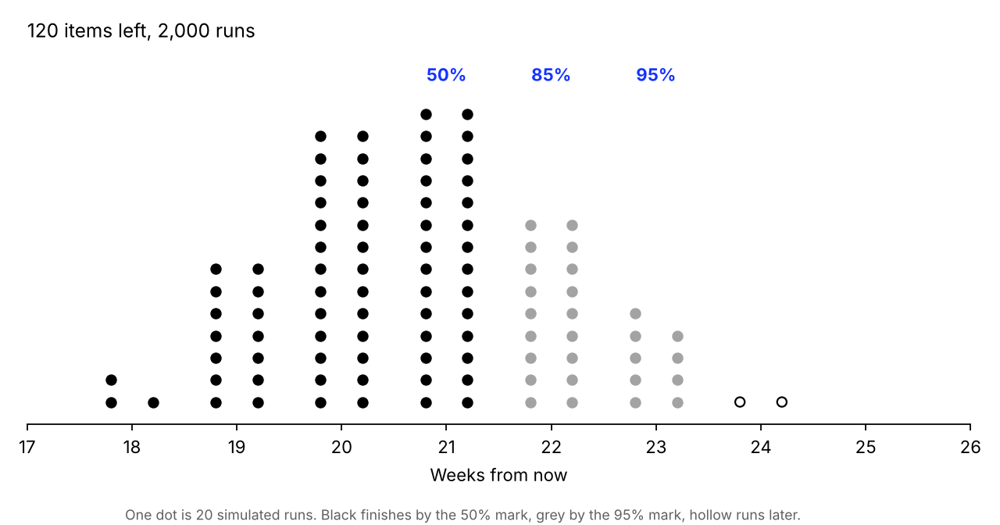

# When will it ship?

"When will it be done?" never has one honest answer. A team that finishes six things a week on average does not finish six things every week. Some weeks it is two, some weeks it is nine, and a plan built on the average is late about half the time.

This tool gives a range instead of a single date. It plays the rest of the project out 2,000 times, using how much the team really got done in past weeks, and reports when half of those runs finished and when almost all of them did.



## Try it

You need Python 3.9 or newer. Nothing else is required to get the forecast.

```
python forecast.py --remaining 120
```

That uses the made-up team in `sample_history.csv` and prints something like this:

```
120 items left. 2,000 simulated runs, drawn from 16 weeks of history (2 to 9 a week, 5.9 on average).

  week  17   0.4%  #
  week  18   2.6%  ####
  week  19  13.6%  ####################
  week  20  26.1%  ######################################
  week  21  27.8%  ########################################  <- 50%
  week  22  18.2%  ##########################  <- 85%
  week  23   8.6%  ############  <- 95%
  week  24   2.1%  ###
  week  25   0.5%  #
  week  26   0.2%  #

   50% of runs finished within 21 weeks, by Apr 13, 2027
   85% of runs finished within 22 weeks, by Apr 20, 2027
   95% of runs finished within 23 weeks, by Apr 27, 2027

The average-speed guess would be 20.4 weeks. Promise the 95% date, not that one.
```

The average says 20.4 weeks. Only about four runs in ten were done by then. That gap is the whole reason this exists.

To save the chart as a picture, install matplotlib and add `--chart`:

```
pip install -r requirements.txt
python forecast.py --remaining 120 --chart forecast.png
```

## Use your own numbers

Make a CSV with one row per week and a column called `completed`:

```
week_ending,completed
2026-10-23,5
2026-10-30,7
2026-11-06,6
```

Then point the tool at it:

```
python forecast.py --remaining 45 --history my_team.csv
```

Only the `completed` column is read, so any other columns can stay. If your team uses Jira, export the resolved issues, count them per week in a spreadsheet, and save that as a CSV. Count whatever your team counts: stories, tickets, batch records, invoices.

Other options:

| Option | What it does |
| --- | --- |
| `--runs 5000` | Play the project out more times. The default is 2,000. |
| `--start 2026-12-01` | Count from this date instead of today. |
| `--confidence 50 80 90` | Report different confidence levels. |
| `--seed 4` | Fix the random numbers so the same run can be repeated. |

## How it works

1. Read the weekly history.
2. For one run, pick a past week at random and subtract what the team finished that week from what is left. Repeat until nothing is left. Write down how many weeks it took.
3. Do that 2,000 times.
4. Sort the results. The week by which 85% of the runs had finished is the 85% date.

Picking whole past weeks at random means the forecast keeps the team's real bad weeks and real good weeks. It does not assume the work follows a tidy curve.

## What it does not know

- It assumes the next few months look like the weeks in the history. A team that just lost two people, or is about to hit a holiday, will not match.
- It treats every item as about the same size. If the remaining work is much bigger or smaller than usual, the answer will be off.
- It does not know about scope. If the list of remaining items keeps growing, re-run it with the new number.
- With fewer than about eight weeks of history, treat the result as a rough guide. The tool refuses to run on fewer than four.

## Tests

```
python -m unittest
```

There are 13 tests. They check the simple cases by hand (a team that does exactly five a week takes exactly twelve weeks for sixty items), that the same seed gives the same answer, and that bad files are rejected with a clear message.

## Files

- `forecast.py` is the whole program.
- `sample_history.csv` is 16 weeks of made-up history for trying it out.
- `test_forecast.py` holds the tests.
- `example.png` is the chart at the top of this page.
